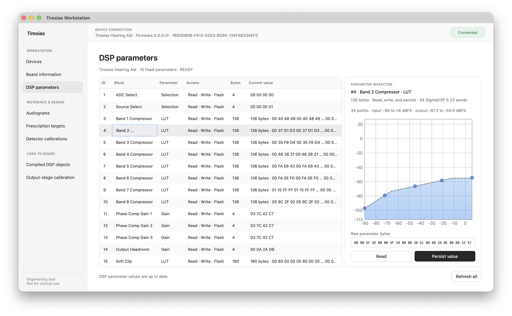

# Tiresias Workstation

Tiresias Workstation is the desktop application used to configure and inspect
the Tiresias DK, an experimental hearing-aid development kit. It gives
researchers and developers a practical way to work with the device without
having to construct Bluetooth Low Energy (BLE) messages or edit DSP parameter data by hand.

The application keeps fitting and calibration data on the computer, converts
that data into the format expected by the embedded audio processor, and sends
supported parameters to the board over BLE. It is an engineering and
characterization tool, not a clinical fitting system.



## What it does

Users can prepare a fitting before connecting a board. They can start with one
of the ten included Bisgaard audiograms or enter hearing thresholds for both
ears, then generate a prescription target. Combining the target for one ear
with detector calibration data produces parameter tables for the board. The
application keeps audiograms, targets, calibrations, compiled DSP objects, and
output-stage configurations in a local library. Saved objects retain their
source data and versions, so the origin of a compiled result can be inspected.

When a board is connected, the application shows its information and current
DSP parameter values. It checks that the board's protocol and parameter
definitions match before reading or loading values. Users can then transfer a
compiled fitting or output-stage configuration and see which parameter writes
the board has confirmed.

## How it is built

The workstation runs as one Python desktop process.
[PySide6](https://doc.qt.io/qtforpython-6/) provides the
[Qt](https://doc.qt.io/qt-6/) interface, while
[Bleak](https://bleak.readthedocs.io/en/stable/) uses the operating system's
Bluetooth stack on macOS, Windows, and Linux. A pinned
[pyClarity](https://github.com/claritychallenge/clarity) adapter provides
[CAMFIT](https://github.com/claritychallenge/clarity/blob/main/clarity/enhancer/gha/gainrule_camfit.py)
target generation, and the application stores its data as local JSON files.

The code separates the interface, the operations it coordinates, the fitting
data models, and the adapters for external libraries and the board protocol.
This lets an audiogram or target exist without Qt or a BLE connection. It also
lets the fitting calculations and device communication be tested separately,
using a simulated transport in place of a board.

The work runs in different threads because the interface needs to respond to
input while Bluetooth operations wait for the device and fitting calculations
complete. Each thread has a specific role:

- The **Qt main thread** owns the windows and widgets. It handles input and
  displays results because Qt requires interface updates on this thread.
- The dedicated **BLE thread**, named `tiresias-ble`, runs an
  [asyncio](https://docs.python.org/3/library/asyncio.html) event loop for scans,
  connections, parameter reads and writes, and board loads. It stays alive
  while the window is open so Bleak objects remain on the event loop that owns
  them.
- **Fitting worker threads** run CAMFIT generation and DSP compilation through
  a Qt thread pool. These calculations need no board connection, and each
  editor runs at most one at a time.

The background threads send results back through Qt signals, which the main
thread uses to update the interface. This keeps Bluetooth waits and fitting
calculations from blocking user input.

## Requirements

- [uv](https://docs.astral.sh/uv/getting-started/installation/)
- Python 3.11 or newer

## Run locally

```sh
uv sync
uv run tiresias-workstation
```

The package can also be run as a module:

```sh
uv run python -m tiresias_workstation
```

## Package for macOS

Build a local app bundle with:

```sh
./scripts/build_macos.sh
```

The result is `dist/Tiresias Workstation.app`. Python, Qt, the fitting
dependencies, reference data, and the Bluetooth permission description are
included in the bundle. See
[`tiresias-workstation.spec`](tiresias-workstation.spec) for the packaging
configuration.

## Documentation and tests

Product requirements, architecture, interface notes, fitting workflows, and
the roadmap are indexed in the [project documentation](docs/README.md).

The automated tests use fake BLE transports and Qt's offscreen backend, so they
do not require a Bluetooth adapter or physical Tiresias DK:

```sh
QT_QPA_PLATFORM=offscreen .venv/bin/python -m unittest discover -s tests -v
```
