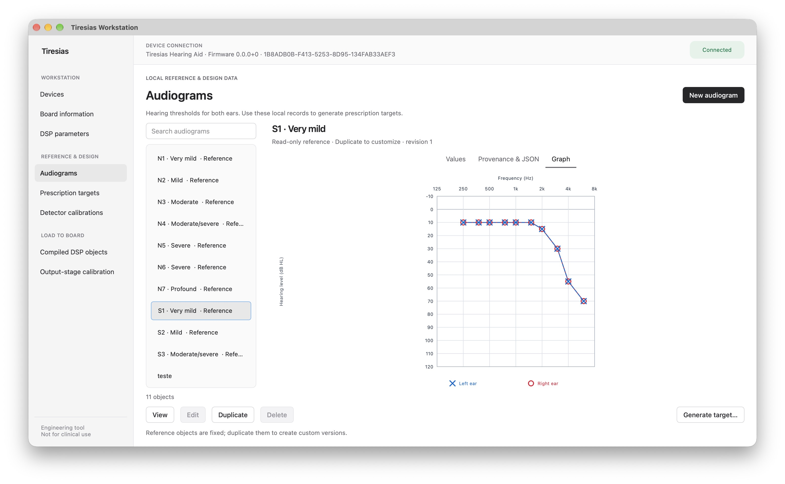

# Tiresias Workstation

Tiresias Workstation is a cross-platform PySide6 desktop application for
discovering, configuring, and loading the Tiresias DK over Bluetooth Low
Energy (BLE).



## What it does

- Discovers and connects to Tiresias DK devices over BLE.
- Reads device information and validates the DSP parameter contract.
- Manages audiograms, prescription targets, detector calibrations, compiled
  DSP objects, and output-stage calibration data.
- Generates CAMFIT targets from two-ear audiograms through a pinned pyClarity
  adapter.
- Keeps fitting data available offline and performs BLE/fitting work away from
  the Qt UI thread.

> Engineering tool for Tiresias DK development; not intended for clinical use.

## Requirements

- [uv](https://docs.astral.sh/uv/getting-started/installation/)
- Python 3.11 or newer

## Quick start

```sh
uv sync
uv run tiresias-workstation
```

Alternatively, run the package as a module:

```sh
uv run python -m tiresias_workstation
```

## Package for macOS

Build a local app bundle with:

```sh
./scripts/build_macos.sh
```

The result is `dist/Tiresias Workstation.app`. Python, Qt, fitting
dependencies, reference data, and the Bluetooth permission description are
included in the bundle. See [`tiresias-workstation.spec`](tiresias-workstation.spec)
for packaging details.

## Documentation

Product requirements, architecture, interface notes, fitting workflows, and
the roadmap are indexed in the [project documentation](docs/README.md).

## Development

Dependencies are declared in `pyproject.toml` and locked in `uv.lock`. Run the
test suite with the offscreen Qt backend:

```sh
QT_QPA_PLATFORM=offscreen .venv/bin/python -m unittest discover -s tests -v
```
